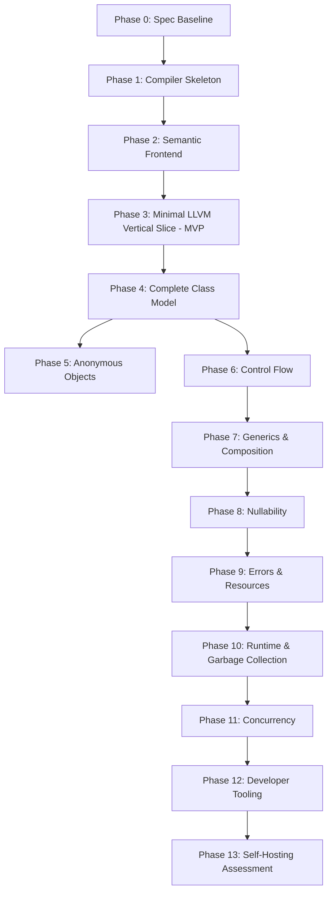

# Master Implementation Plan: Timawa Compiler & Native Runtime

This document serves as the master implementation reference for building the **Timawa** compiler and native runtime in Rust targeting LLVM IR.

---

## 1. Project Repository Structure

```text
Timawa/
├── Cargo.toml                      # Workspace definition
├── LANGUAGE_SPEC_DRAFT.md          # Baseline language specification
├── ARCHITECTURE.md                 # Compiler & runtime architecture
├── DECISIONS_NEEDED.md             # 40 unresolved design decision resolutions
├── MILESTONES.md                   # Phased execution roadmap & estimates
├── IMPLEMENTATION_PLAN.md          # Master implementation plan
├── compiler/                       # Crate: talas-compiler
│   ├── Cargo.toml
│   └── src/
│       ├── main.rs                 # talas CLI driver
│       ├── lib.rs                  # Compiler library entrypoint
│       ├── diagnostics/            # Span tracking & colorized diagnostic emitter
│       ├── lexer/                  # Hand-written token scanner
│       ├── parser/                 # Hand-written Pratt parser & AST
│       ├── resolver/               # Scope symbol table & package resolver
│       ├── types/                  # Type system representations
│       ├── semantics/              # Semantic validator & flow-sensitive narrowing
│       ├── ir/                     # Custom Typed Timawa IR builder (CFG SSA)
│       └── llvm/                   # Textual & Inkwell LLVM IR code generator
├── runtime/                        # Crate: talas-runtime (C-ABI static/shared library)
│   ├── Cargo.toml
│   └── src/
│       ├── lib.rs
│       ├── memory.rs               # Heap allocator & object headers
│       ├── gc.rs                   # Precise incremental mark-and-sweep collector
│       ├── strings.rs              # Immutable UTF-16 string runtime primitives
│       ├── io.rs                   # Standard I/O C-ABI wrappers
│       ├── collections.rs          # Built-in generic collection representations
│       └── concurrency.rs          # Task scheduler & stack management
├── standard-library/               # Core Timawa standard library packages
│   └── prelude.talas
├── tests/                          # Compiler & runtime integration tests
│   ├── integration_tests.rs
│   └── fixtures/                   # Valid and invalid test source code files
└── tools/                          # Developer tooling (talas-fmt, talas-lsp)
```

---

## 2. Toolchain & Dependency Matrix

| Component | Technology / Library | Version / Pinned Feature | Purpose |
| :--- | :--- | :--- | :--- |
| **Compiler Language** | Rust | 1.75+ | High-performance, memory-safe compiler implementation |
| **Build Tool** | Cargo | Native | Workspace management and packaging |
| **LLVM Backend** | LLVM / Inkwell | LLVM 16.0 (`llvm16-0` feature) | In-memory LLVM IR module construction & object generation |
| **Native Linker** | LLD (`lld-sys` / system lld) | Pinned to LLVM 16 | Native executable linking |
| **Snapshot Testing** | `insta` | Latest | AST, IR, and LLVM IR snapshot regression testing |
| **Fuzzing** | `cargo-fuzz` / libFuzzer | Latest | Lexer, parser, and type checker security fuzzing |

---

## 3. Risk Register & Mitigation Strategies

| Risk ID | Technical Risk Description | Severity | Probability | Mitigation Strategy |
| :---: | :--- | :---: | :---: | :--- |
| **R-01** | **Pure OOP Bootstrapping vs. Native Entry Point**: Mapping pure OOP instance methods to LLVM C-ABI `main(int, char**)` without permitting static methods. | **High** | Low | Compiler generates a synthetic native `main` entry function that instantiates `Application` and calls `this.main()`. |
| **R-02** | **GC Stack Map Generation**: Incomplete LLVM stack maps causing precise collector to miss root pointers on task stacks. | **High** | Medium | Use LLVM `statepoint` intrinsics and validate shadow stack fallbacks during MVP phase. |
| **R-03** | **Generic Monomorphization Bloat**: Excessive monomorphization resulting in binary size bloat across package boundaries. | **High** | Medium | Implement duplicate monomorphization pruning and fall back to pointer-erased generic layouts for object types. |

---

## 4. MVP Definition & Acceptance Criteria

The **Minimum Viable Product (MVP)** is defined at the end of **Phase 3**.

### MVP Scope Requirements:
- Lexer and Pratt parser supporting basic syntax, class declarations, instance methods, and expressions.
- Basic types: `int`, `decimal`, `bool`, `string`.
- Immutable local variable bindings and explicit `this` enforcement.
- Pure OOP Application entry point (`Application.main()`).
- Custom Typed Timawa IR lowered to Textual LLVM IR (`.ll`).
- Native executable linking using bundled `talas-runtime` static library.

### MVP Acceptance Criterion:
A valid Timawa source file (`hello.talas`) compiles directly to a native executable and produces exact output when executed natively:

```java
class Application {
    void main() {
        final console = Console()
        console.println(`Hello, Timawa!`)
    }
}
```

---

## 5. Valid & Invalid Code Examples

### 5.1 Valid Timawa Code Example

```java
class User(
    long id,
    string name,
    var int age = 0
) {
    void birthday() {
        this._age = this._age + 1
    }
}

class Application {
    void main() {
        final user = User(1000, `Lem`, 35)
        user.birthday()
        
        if (user.age() > 30) {
            final console = Console()
            console.println(`User ${user.name()} is ${user.age()} years old.`)
        }
    }
}
```

### 5.2 Invalid Code Examples & Expected Compiler Diagnostics

#### Example 1: Missing Explicit `this`
```java
class User(long id, var int age) {
    void birthday() {
        _age = _age + 1  // Invalid: missing 'this.'
    }
}
```
**Expected Compiler Diagnostic**:
```text
error: instance field '_age' must be accessed through 'this'
  --> src/user.talas:3:9
   |
 3 |         _age = _age + 1
   |         ^^^^ help: use 'this._age'
```

#### Example 2: Reassigning Immutable Field
```java
class User(long id, string name) {
    void updateName(string newName) {
        this._name = newName  // Invalid: _name is immutable
    }
}
```
**Expected Compiler Diagnostic**:
```text
error: cannot reassign immutable field '_name'
  --> src/user.talas:3:9
   |
 3 |         this._name = newName
   |         ^^^^^^^^^^ field '_name' is declared immutable (without 'var')
```

---

## 6. Component Dependency Graph



---

## 7. Critical Path Analysis

The critical path for Timawa development follows:
$$\text{Phase 0} \rightarrow \text{Phase 1} \rightarrow \text{Phase 2} \rightarrow \text{Phase 3 (MVP)} \rightarrow \text{Phase 4} \rightarrow \text{Phase 6} \rightarrow \text{Phase 7} \rightarrow \text{Phase 10} \rightarrow \text{Phase 11}$$

- Total Critical Path Duration: **63 Engineer-Weeks**.
- Non-critical parallel paths: Phase 5 (Anonymous Objects), Phase 8 (Nullability), Phase 9 (Errors & Resources), and Phase 12 (Tooling).

---

## 8. Testing Strategy

Timawa implements a comprehensive multi-layered testing regime:

1. **Unit Tests**: Test individual compiler components (Lexer token scanner, Pratt parser expression nodes, Symbol table scoping).
2. **Snapshot Tests (`insta`)**: Validate exact output of AST representations, Typed IR nodes, and generated textual LLVM IR.
3. **Negative Compilation Tests**: Validate that illegal constructs (missing `this`, mutating immutable fields, bad type assignments) produce accurate diagnostic error messages.
4. **Fuzz Testing (`cargo-fuzz`)**: Continuous randomized byte fuzzing of Lexer and Parser components to prevent panics or infinite loops.
5. **GC Stress & Memory Leak Tests**: Continuous allocation loops verified using Valgrind / AddressSanitizer (ASan).

---

## 9. Performance & Target Platforms

### 9.1 Initial Performance Targets
- **Compiler Startup**: < 15ms.
- **Compilation Speed**: > 50,000 lines of code per second (debug mode).
- **Native Binary Startup**: < 5ms.
- **Binary Size**: < 3.5 MB for Hello World native executable (including runtime).

### 9.2 Target Platform Hierarchy
1. **Linux x86-64** (`x86_64-unknown-linux-gnu`) — Primary Development & CI target.
2. **Linux ARM64** (`aarch64-unknown-linux-gnu`) — Cloud native & server target.
3. **Windows x86-64** (`x86_64-pc-windows-msvc`) — Windows desktop target.
4. **macOS ARM64** (`aarch64-apple-darwin`) — Apple Silicon developer target.

---

## 10. First Recommended Vertical Slice

The recommended **First Vertical Slice** (Phase 3 MVP) consists of building:
1. Lexer scanner for keywords, identifiers, backtick strings, and numbers.
2. Parser for `class Application { void main() { ... } }` and local variable declarations.
3. Type Checker enforcing explicit `this` and default initialization.
4. Typed IR lowering to textual LLVM IR `.ll` file emitting `call void @talas_print_str(...)`.
5. Direct execution of native binary produced by invoking `clang` / `lld` against the generated `.ll` and native `talas-runtime` static library.
